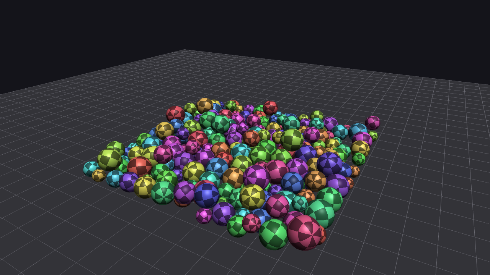

# Sphere Physics Engine

A small rigid-body physics engine for spheres in C++20, with an OpenGL 3.3 viewer. Spheres fall,
bounce, slide, roll and collide with restitution and Coulomb friction. Friction at the contact
point produces torque, so a sliding ball spins up and settles into rolling on its own.

Every result is checked against a closed-form answer in the test suite: free fall, bounce height,
the 5/7 slide-to-roll speed, momentum conservation and bitwise determinism.



## Build and run

Requires CMake 3.24+ and a C++20 compiler (Apple Clang 15+ or MSVC 2022). Dependencies are
fetched and pinned by CMake: GLFW 3.4, GLM 1.0.1, Catch2 3.7.1. glad is vendored.

```sh
git clone https://github.com/Delozz/physics-engine.git && cd physics-engine
cmake -S . -B build -DCMAKE_BUILD_TYPE=Release
cmake --build build --config Release
```

```sh
./build/engine_app                                     # viewer (Windows: build\Release\engine_app.exe)
ctest --test-dir build -C Release --output-on-failure  # acceptance tests
./build/physics_tests "[.benchmark]"                   # step timing
```

## Controls

| Input | Action |
|-------|--------|
| Left drag | Orbit camera |
| Scroll | Zoom |
| `1`-`4` | Drop and Bounce, Slide to Roll, Collisions, Sphere Pile |
| `Space` | Pause / resume |
| `N` | Single step while paused |
| `R` | Reset scene |
| `B` | Spawn 10 spheres |
| `C` | Show contact points |
| `Esc` | Quit |

## Architecture

```
   engine_app  (main loop, input, scenes)
     |      \
   render -> physics   (World, RigidSphere, collision, solver, integrator)
                ^
          physics_tests
```

`physics` is a headless static library that depends only on GLM, so the tests run without a
window. `render` reads `World` state as const and never writes back.

`World::step(dt)` runs a fixed sequence at `dt = 1/120 s`:

1. Gravity and accumulated forces into velocities
2. Detect contacts (sphere-plane, then sphere-sphere, brute force by ascending id)
3. Sequential-impulse velocity solve, 10 iterations
4. Clamp speeds (20 m/s, 100 rad/s)
5. Integrate positions (semi-implicit Euler) and orientations (exponential map)
6. Positional correction (slop 1 mm, 80 %)

A few choices worth calling out:

- **Scalar inertia.** A solid sphere has `I = 0.4 m r^2` about every axis, so no tensor is needed.
- **Exponential-map rotation.** `q = angleAxis(|w| dt, w/|w|) * q` instead of `q += 0.5 dt w q`,
  which drifts as `|w| dt` grows.
- **Accumulated impulse clamping.** The normal impulse is clamped to `>= 0` and the friction
  impulse to the cone `|jt| <= mu * jn` on the running totals, not per iteration.
- **Shared contact point.** Both bodies apply the impulse at the midpoint of the overlap, so the
  solver conserves angular momentum to machine precision.
- **No continuous collision detection.** Tunneling is ruled out by the speed clamp and a
  0.25 m minimum radius: 40 m/s relative speed covers 0.33 m per step, less than the 0.5 m
  smallest radius sum.

## Validation

All tests are headless, use `World` only and step at 1/120 s. Measured on a MacBook Pro M4,
Release build.

| Test | Expected | Measured |
|------|----------|----------|
| Free fall, 1 s from y = 10 | 5.095 m ± 0.05 | 5.054 m (semi-implicit Euler lag ≈ ½ g t dt) |
| Spin at 10 rad/s, 10,000 steps | angle error < 1e-6 rad | 1.4e-13 rad, \|q\| = 1 |
| Bounce, e = 0.5, 1 m drop | apex 0.25 m ± 0.05 | 0.264 m |
| Inelastic drop comes to rest | v < 0.01 m/s, y = r ± 5 mm | 0 m/s, 0.499 m |
| Slide to roll, v0 = 5 m/s | v = 5·5/7 = 3.571 m/s ± 3 % | 3.570 m/s, ω = −v/r within 0.1 % |
| Elastic head-on, equal mass | velocities swap ± 1e-6 | swapped, Δp < 1e-9 |
| Glancing hit with friction | impulses conserve L ± 1e-3 | 2e-16 relative, both spheres spin |
| Friction cone | \|jt\| ≤ μ·jn | 0.1 ≤ 0.1 |
| 200-sphere pile, 10 s | finite, penetration ≤ 1 cm | 1.4 mm worst case |
| Determinism, same seed twice | bitwise equal | equal |

| Benchmark | Target | Measured |
|-----------|--------|----------|
| `World::step`, 200 spheres | ≤ 2 ms | 0.16 ms |
| `World::step`, 500 spheres | ≤ 8 ms | 0.66 ms |

**Known limitation.** Positional correction moves bodies along the normal without touching their
velocities. In the glancing collision the spheres are still sliding past each other when they get
pushed apart, which changes `m (r × v)`: total angular momentum across the full steps drifts by
1.5 %. The impulses themselves conserve it exactly; the test prints the full-step figure as a
warning on every run.

## License

MIT
